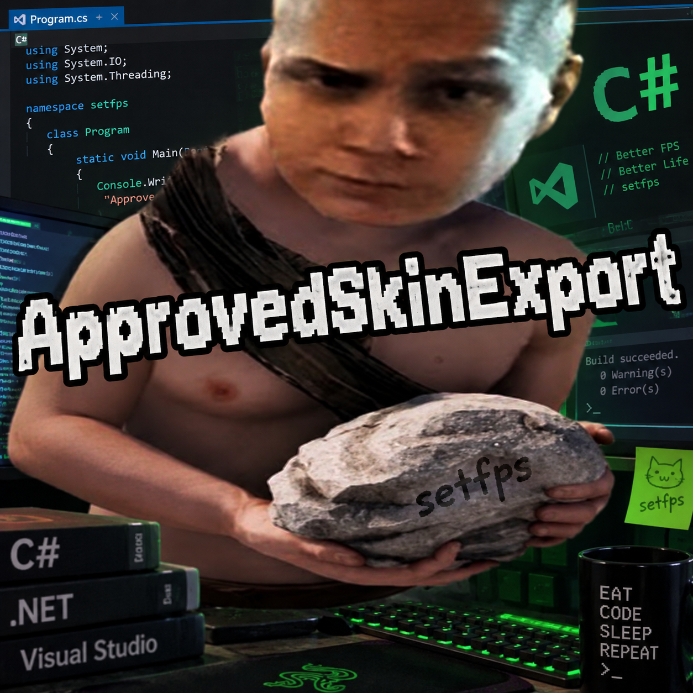

# Approved Skin Export



Мод для выгрузки списка скинов из класса `Approved` в `Rust.Workshop`. Работает через [BepInEx](https://github.com/BepInEx/BepInEx) для IL2CPP.

Сохраняет скины по предметам: названия предметов сортируются по алфавиту, ID — по возрастанию, повторяющиеся ID удаляются внутри каждой группы.

## Установка

Поместите `ApprovedSkinExport.dll` в папку `BepInEx/plugins` и запустите игру. После загрузки ресурсов мод автоматически выполнит экспорт в `BepInEx/exports/approved-skins`.

## Файлы экспорта

- `skins-workshop.txt` — Workshop ID скинов, сгруппированные по shortname предмета.
- `skins-inventory.txt` — ID определений предметов в Steam Inventory, сгруппированные по shortname.
- `skins-details.tsv` — подробная таблица с названиями скинов и обоими видами ID.

Экспортируется каталог `Approved` вашей версии клиента. Мод не скачивает файлы скинов.

## Сборка

Нужны .NET 6 SDK и DLL из папок `core` и `interop` установленного BepInEx IL2CPP. Укажите путь к своей папке BepInEx:

```powershell
dotnet build -c Release "-p:BepInExDir=C:\Path\To\BepInEx"
```

Готовый мод: `bin/Release/net6.0/ApprovedSkinExport.dll`. Исходный код использует синтаксис C# 4.0.

Контакт автора: [@setfps](https://t.me/setfpsdev).
